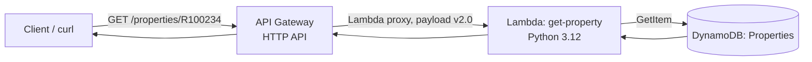
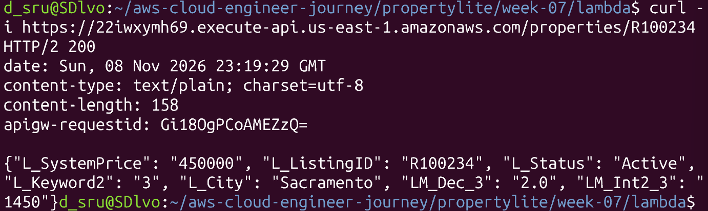
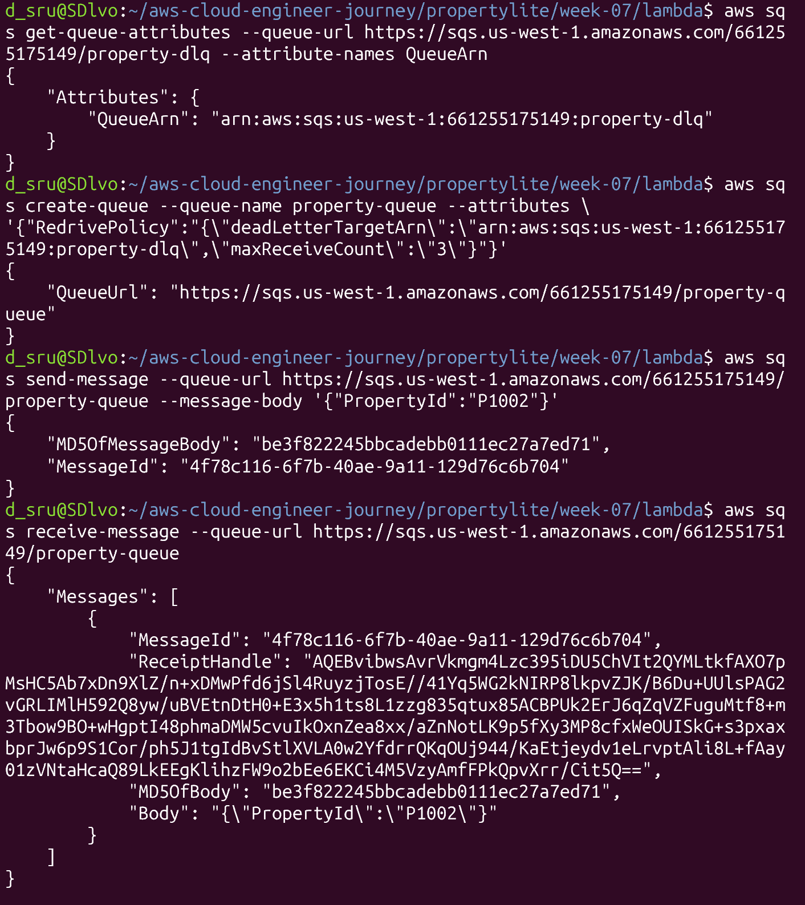

# AWS Cloud Engineer Journey

## Week 01: Root vs IAM vs Shared Responsibility Model:
  - The root user account is the master account that is automatically created along with your AWS account, has no limitations to power, but should only be used for billing or MFA tasks. The IAM account is a user account with specific permissions assigned to by the root account. This account is used for everyday work such as operating AWS CLI or operating within the set boundaries/permissions. The shared responsibility model ensures the guidelines between the user and AWS, highlighting that the user is responsible for protecting their work and account while AWS handles the physical components of where the data is stored. AWS stored the data and secures the cloud while the user is entirely responsible for making sure their work is secured with the right passwords and account IDs by efficiently using the root and IAM users.

## Week 02: IAM Policies:
### S3UploaderOnly-sruti

This policy allows the 's3-test-user' to upload and download specific objects in the 'my-training-bucket-sruti' S3 bucket.

The policy allows:
- 's3:PutObject': allows user to upload objects
- 's3:GetObject': allows user to retrieve/download objects

Scope:
- The policy uses the scope of the training bucket, 'arn:aws:s3:::my-training-bucket-sruti/*'.
- The '/\*' ensures that the permissions apply to objects inside the bucket since without the '/\*' only refers to the bucket itself, not the objects.
- This policy limits the users access to this particular bucket rather than giving the user all access to the S3 resources.

## Week 03: Compute: EC2:

## Week 04: Storage & Databases:

## Week 05: Networking:

Built a training-vpc with 2 public and 2 private subnets across 2AZs, an Internet Gateway and one Nat Gateway. Then launched a bastion in public subnet and a private instance inside a private subnet.

- VPC (Virtual Private Cloud): own logically isolated network inside AWS, you can control its newtork. -> created a training-vpc
- Subnets: a smaller network inside the VPC in which you can organize resources based on purpose
    - Public: hosts resources that need a route to the internet
    - Private: hosts resources that shouldn't be directly accessed from the internet
- Bastion host: a server that acts as a controlled entry point into a private network

### Traffic Flow:
1. My laptop connects to bastion host in a public subnet through SSH using a security group that restricts access to my IP address.

2. The bastion host connects to the private EC2 instance using its private IP address. Then, the private instance's security group allows SSH only from the bastion host's security group.

3. The Internet Gateway enables internet connectivity for resources in public subnets, while the NAT Gateway allows private instances to initiate outbound internet connections without being directly accessible from the internet.

4. Private subnet route tables must point to the NAT Gateway for outbound internet access.

## Week 06: Elastic Load Balancing & Auto Scaling:

### Setup
- ALB: property-api-alb (HTTP 80) → target group property-api-tg (port 8080, health check /health)
- ASG: property-api-asg, min 1 / desired 2 / max 4, launch template property-api-template (v2)
- Scaling policy: target tracking, average CPU 50%
- Instances: t3.micro, Amazon Linux 2023, default VPC (public subnets, no NAT gateway)

### Self-healing test
Manually terminated i-0ec204f2e1131b0d8 in the EC2 console. The ASG detected it at
20:45:28 and launched replacement i-0e388985628db2c75 at 20:45:30
(detection-to-launch: ~2 seconds).

### Scale-out test
- Stress started (`stress-ng --cpu 2 --timeout 600s`): ~20:18:30 on the instance at 184.72.26.38
- CPU crossed 50%: 20:20 datapoint (~100%)
- AlarmHigh #1: 20:24:55, desired 1 → 2, instance launched 20:25:02
- AlarmHigh #2: 20:30:55, desired 2 → 4 (max reached), instances launched 20:31:01
- **Gap between CPU spike and first scale-out: ~5 minutes** (CloudWatch data is 5-minute granularity)

The group started the test at 1 instance rather than 2 because the AlarmLow policy had
scaled in the idle group at 20:13. At 20:39 I manually lowered desired capacity from 4
to 2 to end the test.

### Observations
- **Why the delay:** target tracking only fires after several consecutive datapoints
  above target, so scale-out lags the CPU spike by a few minutes.
- **502 debugging (Lab 6.3):** targets were unhealthy and the ALB returned 502. The
  security group rule and health check were fine. The system log showed cloud-init
  ignoring my user data ("Unhandled non-multipart userdata") because it began with raw
  Python instead of a shebang, so Flask never started. Fix: a `#!/bin/bash` script that
  installs pip and Flask, writes app.py and the CSV, and runs the app as a systemd
  service.
- **Side effect:** with ELB health checks on, the ASG kept replacing the broken
  instances until the user data was fixed.
- **Scale-in:** target tracking also removes instances when CPU is low (20:13 and 19:49).
- **What I'd tune:** a longer health check grace period, a lower max or cooldown to
  avoid jumping 2 → 4, and 1-minute group metrics for tighter timing.


## Week 07: Serverless & Event-Driven Architecture

## Request path



- **API Gateway:** HTTP API `propertylite-api`, route `GET /properties/{id}` (us-east-1)
- **Lambda:** `get-property` reads `event['pathParameters']['id']` and calls `GetItem` on `L_ListingID` (us-west-1)
- **DynamoDB:** `Properties` table, partition key `L_ListingID` (us-west-1)

This is the same lookup the Flask route in `propertylite/app.py` does against a CSV, now backed by DynamoDB.

I took PropertyLite's "get one listing" feature and ran it without a server. Instead of an always-on EC2 instance, a request now flows through three AWS services that only run when someone calls them.

## Lab 7.1: Serverless listing lookup

**How a request flows:**

```
curl → API Gateway → Lambda → DynamoDB → back to curl
```

1. **API Gateway** receives the web request (`GET /properties/R100234`).
2. **Lambda** runs my Python function, which reads the listing ID from the URL.
3. **DynamoDB** stores the listings; Lambda looks up that ID and returns the result.

This is the same lookup as the Flask `get_property` route. The only difference is that it reads DynamoDB instead of a CSV file. Week 4's database had been torn down, so I loaded the two sample rows from the Week 0 CSV.

Code: [`lambda/lambda_function.py`](lambda/lambda_function.py)

**Results:** a real ID returns the listing (200), and a fake ID returns an error (404).

```
$ curl -i https://22iwxymh69.execute-api.us-east-1.amazonaws.com/properties/R100234
HTTP/2 200
{"L_SystemPrice": "450000", "L_ListingID": "R100234", "L_Status": "Active", "L_Keyword2": "3", "L_City": "Sacramento", "LM_Dec_3": "2.0", "LM_Int2_3": "1450"}

$ curl -i https://22iwxymh69.execute-api.us-east-1.amazonaws.com/properties/NOPE
HTTP/2 404
{"error": "not found"}
```



**Permissions (least privilege):** the Lambda is only allowed to read from the `Properties` table:

```json
{
  "Version": "2012-10-17",
  "Statement": [{
    "Effect": "Allow",
    "Action": "dynamodb:GetItem",
    "Resource": "arn:aws:dynamodb:us-west-1:661255175149:table/Properties"
  }]
}
```

It can do one thing (read one item) on one table. If the function had a bug or was compromised, it still couldn't touch anything else in the account.

**Problem I hit:** the API returned `"Hello from Lambda!"` instead of a listing. The API setup was correct, but the Lambda was still running AWS's default starter code. Testing the Lambda directly with `aws lambda invoke` showed this, and deploying my real code fixed it.

## Lab 7.2: SQS dead-letter queue

I created two queues. `property-queue` is the main one, and `property-dlq` is where messages go if they fail 3 times (`maxReceiveCount: 3`), so one bad message doesn't retry forever.

```bash
aws sqs create-queue --queue-name property-dlq
aws sqs create-queue --queue-name property-queue --attributes \
'{"RedrivePolicy":"{\"deadLetterTargetArn\":\"arn:aws:sqs:us-west-1:661255175149:property-dlq\",\"maxReceiveCount\":\"3\"}"}'
aws sqs send-message --queue-url https://sqs.us-west-1.amazonaws.com/661255175149/property-queue --message-body '{"PropertyId":"P1002"}'
aws sqs receive-message --queue-url https://sqs.us-west-1.amazonaws.com/661255175149/property-queue
```

`receive-message` returned the message I sent (`{"PropertyId":"P1002"}`), so it worked.



## Key terms

- **Lambda:** runs code on demand with no server to manage; you pay only when it runs.
- **Cold start:** the first call after idle time is slower because AWS has to start the environment.
- **API Gateway:** the public URL that triggers the Lambda.
- **SQS:** a message queue. The **DLQ** collects messages that keep failing.
- **SNS:** sends one message to many subscribers (email, queues, etc.).
- **Debugging rule:** for a Lambda error, check CloudWatch Logs first.
