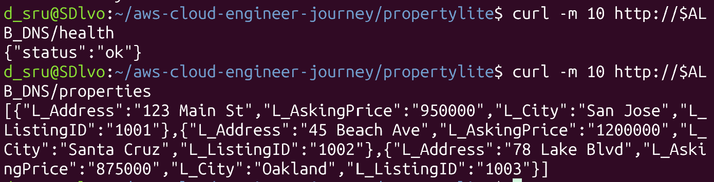
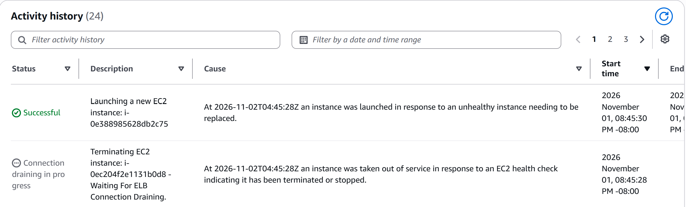
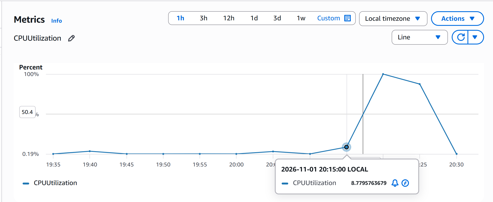
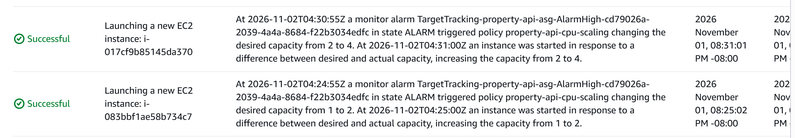

# Week 06: Load Test Report (ELB & Auto Scaling)

## Overview
This week I put a small web app (PropertyLite) behind an AWS Application Load Balancer (ALB) and ran it on an Auto Scaling Group (ASG). The load balancer spreads visitors across servers, and the ASG automatically adds, removes, or replaces servers as needed. I tested three things: that the app works through the load balancer, that a deleted server gets replaced automatically (self-healing), and that the group adds servers when CPU gets busy (scaling).

## Setup
- **ALB:** property-api-alb (HTTP 80) forwarding to target group property-api-tg (port 8080, health check `/health`)
- **ASG:** property-api-asg, min 1 / desired 2 / max 4, launch template property-api-template (v2)
- **Scaling policy:** target tracking, average CPU 50%. The ASG adds servers when average CPU stays above 50% and removes them when it stays low.
- **Instances:** t3.micro, Amazon Linux 2023, default VPC (public subnets, no NAT gateway)

The screenshot below shows the app working through the load balancer. `/health` returns `{"status":"ok"}` and `/properties` returns the sample listings.

## Debugging: ALB returned 502 Bad Gateway (Lab 6.3)

**Symptom:** The load balancer's address showed "502 Bad Gateway" instead of my app. A 502 means the load balancer is working but can't get a good answer from the servers behind it.

**What I checked:**
1. **Target group:** 0 healthy, 2 unhealthy. The load balancer considered both servers broken.
2. **Security group:** port 8080 allowed traffic from the load balancer's security group. This was correct.
3. **Health check:** protocol HTTP, path `/health`. This was also correct.

Since the network setup was fine, the problem had to be on the servers themselves.

**Finding the cause:** I opened one server's system log (EC2 → Actions → Monitor and troubleshoot → Get system log). It said cloud-init had skipped my startup script ("Unhandled non-multipart userdata"). My startup script began with raw Python code, but AWS only runs a startup script if its first line says what kind of script it is, such as `#!/bin/bash`. So the script never ran, Flask never started, and nothing was listening on port 8080.

**Fix:** I replaced the startup script with a bash script that:
1. Installs pip and Flask
2. Writes the app file (`app.py`) and the sample CSV
3. Runs the app as a systemd service, so it starts at boot and restarts if it crashes

I saved it as a new launch template version (v2), set it as the default, and let the ASG launch new servers from it. Once they booted, the targets turned healthy and both endpoints worked (screenshot above).

**A side effect I noticed:** I had ELB health checks turned on, so while the servers were broken the ASG kept terminating them and launching new ones, which wouldn't work either. This looked like a loop in the Activity tab. It stopped once the startup script was fixed.

## Self-healing test
**Goal:** show that the ASG replaces a server that disappears.

I manually terminated `i-0ec204f2e1131b0d8` in the EC2 console. The ASG detected it at 20:45:28 and launched replacement `i-0e388985628db2c75` at 20:45:30 (detection-to-launch: ~2 seconds). The other server kept serving traffic in the meantime. The replacement then needed a few minutes to boot and pass health checks before it received traffic.

## Scale-out test
**Goal:** show that the ASG adds servers when CPU gets busy.

I connected to a server over SSH and ran `stress-ng --cpu 2 --timeout 600s`, which keeps both of its CPUs near 100% for 10 minutes.

- **Stress started:** ~20:18:30 (estimated from the server's package-install log)
- **CPU crossed 50%:** 20:20 datapoint (~100%)
- **AlarmHigh #1:** 20:24:55, desired capacity 1 → 2, new instance launched 20:25:02
- **AlarmHigh #2:** 20:30:55, desired capacity 2 → 4 (the maximum), new instances launched 20:31:01
- **Gap between CPU spike and first scale-out: ~5 minutes.** CloudWatch data here is in 5-minute steps, so this is approximate.

**Why the 5-minute delay:** The ASG doesn't react to a brief spike. The CloudWatch alarm waits for several readings in a row above the 50% target, then tells the ASG to add servers. This avoids adding servers for something short-lived.

**Why the group started at 1 server instead of 2:** Before the test, the servers were idle. At 20:13 the low-CPU alarm (AlarmLow) from the same scaling policy removed one, going from 2 to 1. That's the same policy working in the other direction.

**Ending the test:** At 20:39 the group was at 4 servers. I manually lowered the desired capacity from 4 to 2 to stop the test.

## What I learned
- A load balancer needs explicit permission (a security group rule) to reach the servers. "Internet-facing" doesn't mean the servers trust it by default.
- A 502 means the load balancer works but the servers behind it don't. The target group status and the server's system log show why.
- Startup (user data) scripts only run if they start with a `#!` line, and only on first boot, so fixing one means launching new servers.
- With ELB health checks on, the ASG replaces any server that fails them, which is helpful when working and noisy when broken.
- Target tracking scales in as well as out, and it reacts after several minutes, not instantly.

## What I'd do differently
- Put the servers in private subnets (with a NAT gateway) instead of the default VPC.
- Use a longer health check grace period so servers have time to start before being checked.
- Set a lower max capacity or a cooldown to avoid jumping from 2 to 4 servers at once.
- Turn on 1-minute group metrics for more precise timing.

## Cleanup
Deleted in order: ASG, ALB, target group, launch template.
